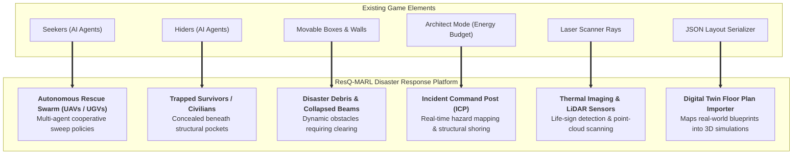
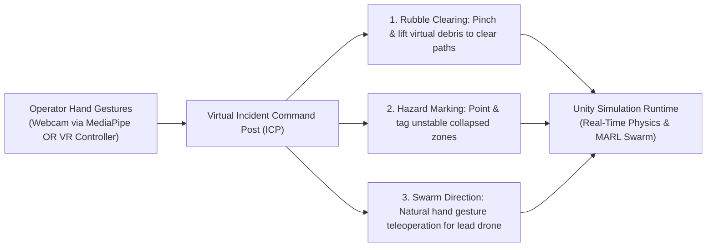

# ResQ-MARL: Autonomous Disaster Response & Urban Search and Rescue (USAR) Testbed
**Transforming Arena from an Entertainment Game into a Simulation & AI Training Platform for Earthquake Rescue Swarms**

---

## 1. Executive Summary & Problem Statement

### 1.1 The Real-World Challenge
In post-earthquake disaster scenarios, collapsed multi-story buildings and damaged urban environments present severe risks to first responders. Structural instability, ongoing aftershocks, toxic dust, and blocked passageways make it hazardous to send human personnel directly into rubble without prior reconnaissance. 

Autonomous Multi-Agent Systems—such as swarms of Unmanned Aerial Vehicles (UAVs) and Unmanned Ground Vehicles (UGVs)—are increasingly deployed to locate trapped survivors. However, training these swarms in the real world is dangerous and expensive. Furthermore, pre-mission reconnaissance requires a **Simulation & Digital Twin environment** where real-world floor plans can be mapped and tested before boots hit the ground.

### 1.2 The Project Transformation
By repurposing our existing Multi-Agent Reinforcement Learning (MARL) engine, we transition Arena from an entertainment hide-and-seek game into **ResQ-MARL**: an interactive simulation and reinforcement learning training platform for autonomous earthquake search-and-rescue.

* **Seekers** become **Autonomous Rescue Drones and Ground Robots (SAR Swarm)**.
* **Hiders** become **Trapped Earthquake Victims / Survivors** sheltered under debris.
* **Movable Boxes** become **Structural Debris, Collapsed Beams, and Concrete Rubble**.
* **Fixed Walls** become **Damaged Building Partitions & Ruined Corridors**.
* **Architect Mode** becomes the **Incident Command Post (ICP)** where disaster coordinators model newly collapsed zones, clear rubble, and design evacuation corridors.
* **The Goal** expands from simple detection to **detecting survivors and securing their extraction back to a designated Safe Triage Zone**.
* **Hand Tracking & VR** provides the **Virtual Incident Commander Station**, enabling natural hand gestures to manipulate rubble and survey the site in immersive 3D.

---

## 2. Academic Titling & Framing

| Dimension | Initial Working State | Proposed Final Product Framing |
| :--- | :--- | :--- |
| **Project Title** | *Arena: An Interactive Multi-Agent RL Game* | **ResQ-MARL: An Autonomous Multi-Agent Reinforcement Learning Simulation & Digital Twin Testbed for Post-Earthquake Urban Search and Rescue (USAR)** |
| **System Classification** | Game Engine Demonstration | **Disaster Robotics & Autonomous Multi-Agent Simulation Suite** |
| **Core Value Proposition** | Entertainment gameplay with reinforcement learning agents. | **A human-in-the-loop digital twin platform that trains autonomous swarms to navigate dynamic rubble, locate survivors, and evaluate building safety before human responders enter.** |

---

## 3. System Architecture & Component Mapping

Every existing module in our Unity codebase maps directly to a critical real-world disaster response function:

### Detailed Functional Mapping
1. **Autonomous Rescue Swarm (Formerly Seekers):**  
   Autonomous agents run trained deep PPO neural policies. Their objective is to cooperatively sweep through damaged rooms, maintain line-of-sight coverage, and locate trapped survivors without duplicating search paths.
2. **Trapped Survivors (Formerly Hiders):**  
   Victims located inside structural pockets or behind fallen furniture. Their goal is self-preservation, staying sheltered until discovered by a rescue drone.
3. **Debris Manipulation & Path Clearance (Formerly BoxHolding):**  
   In disaster zones, paths are blocked by rubble. The existing box-holding and locking mechanics (`BoxHolding.cs`) represent **robotic manipulator arms** pushing aside fallen debris to open passage corridors.
4. **Thermal / LiDAR Life-Sign Scanning (Formerly SeekerLaserScanner):**  
   The raycast laser scanner becomes an infrared/thermal vision cone, detecting survivor body heat through narrow crevices in collapsed walls.
5. **Safe Evacuation Zone (Triage Base):**  
   A dedicated extraction zone marked on the floor. When a survivor is located, the swarm establishes an evacuation vector, escorting or guiding the survivor to the medical triage area.
6. **Real-Life Digital Twin Mapping (Formerly PlayerLayout):**  
   Using the existing JSON layout serialization (`PlayerLayout.cs`), real architectural blueprints or drone scans of earthquake-damaged structures can be imported into the simulation to run pre-mission feasibility assessments.

---

## 4. Addressing the Professor's Feedback: VR & Hand Movement

The professor suggested incorporating **Hand Movement and VR** so the tool has tangible, hands-on utility. In ResQ-MARL, this is integrated as the **Virtual Incident Command Station**:

### How the Interaction Works:
* **Option A: Touchless Webcam Hand-Tracking (MediaPipe / Python UDP Bridge)**
  * *No costly headset required.* A lightweight Python script tracks hand landmarks using a standard laptop webcam.
  * **Pinch Gesture:** Grasp and move virtual debris blocks to open rescue paths.
  * **Open Palm Navigation:** Steer the tactical camera or direct the lead rescue drone.
  * **Point Gesture:** Mark structural hazard zones for the AI swarm to avoid.
* **Option B: Immersive VR Headset Mode (Unity OpenXR)**
  * An incident commander puts on a VR headset to stand inside the 1:1 scale collapsed building, physically surveying debris and guiding autonomous robots.

---

## 5. Five Core Deliverables for the Final Product

To make ResQ-MARL a complete, defensible product for the final review, we implement five modular features:

### 1. Safe Triage & Evacuation Base
* A designated green recovery area on the arena floor.
* When a survivor is tagged by a rescue bot, their status changes to "Rescued," and a waypoint path directs them to the Triage Base.

### 2. Spatial LiDAR & Thermal Coverage Heatmap (`H` Key)
* A dynamically updated \(30 \times 30\) floor overlay.
* **Green/Cyan:** Areas thoroughly scanned by drone thermal sensors.
* **Amber/Red:** High-risk unexplored blind spots (void spaces where survivors might still be trapped under rubble).

### 3. Real-World Disaster Scenario Presets
Pre-configured structural templates available from the Architect UI:
* **Preset 1: Collapsed Office / School Floorplan** (Partitioned rooms with fallen ceiling slabs).
* **Preset 2: Obstructed Corridor & Chokepoint** (Corridor blocked by debris requiring robotic manipulation).
* **Preset 3: Multi-Room Triage & Evacuation Field** (Wide debris zone with multiple scattered survivors).

### 4. Digital Twin Real-World Importer
* An interface allowing users to load real-world floor plan coordinates from `config/player_layout.json` to model actual damaged buildings.

### 5. Automated Mission Analytics & Survival Telemetry
A real-time telemetry HUD and one-click CSV report exporter calculating:
* **Mean Time to Rescue (MTTR):** Average time elapsed before victims are located and extracted.
* **Swarm Clearance Rate (%):** Percentage of the total floor area surveyed by thermal sensors.
* **Survivability Index (%):** Ratio of successful extractions within the operational window.
* **Debris Obstruction Factor:** Quantifying how structural debris delayed rescue operations.

---

## 6. The 5-Minute Final Review Presentation Script

Use this script during the final demonstration to systematically address all review criteria:

* **Minute 1: Problem Context & Humanitarian Value**
  * *"In the aftermath of an earthquake, human first responders cannot safely enter structurally damaged buildings without knowing where survivors are located. ResQ-MARL is an autonomous multi-agent simulation testbed and digital twin platform that trains robotic swarms to navigate rubble, detect trapped victims, and establish safe evacuation routes."*
* **Minute 2: Real-World Scenario Loading & Incident Commander Interaction**
  * Load the **'Collapsed Building'** preset from the UI.
  * Demonstrate the Incident Command mode: show how an operator can model newly collapsed debris and use hand tracking / VR to clear structural obstacles.
* **Minute 3: Thermal / LiDAR Swarm Search & Heatmap Visualization**
  * Start the simulation. Toggle the **Spatial Heatmap (`H`)**.
  * *"Here, our autonomous rescue drones deploy cooperative search policies. The floor heatmap visually proves sensory coverage: green zones are cleared rooms, while red highlights dangerous structural voids that require immediate inspection."*
* **Minute 4: Policy Benchmarking & Emergent Coordination**
  * Switch between the baseline policy and the advanced self-play 200M policy.
  * Demonstrate that trained agents disperse across separate sectors to optimize sweep efficiency rather than redundantly clustering in one room.
* **Minute 5: Triage Extraction & Mission Audit Report**
  * Observe the rescue drone escorting the victim to the green Safe Triage Zone.
  * Click **'Export Audit Report'** to generate the quantitative mission dossier (MTTR, coverage %, survival rate).
  * *"ResQ-MARL bridges deep reinforcement learning with real-world disaster management, saving lives by evaluating rescue plans before sending humans into harm's way."*
