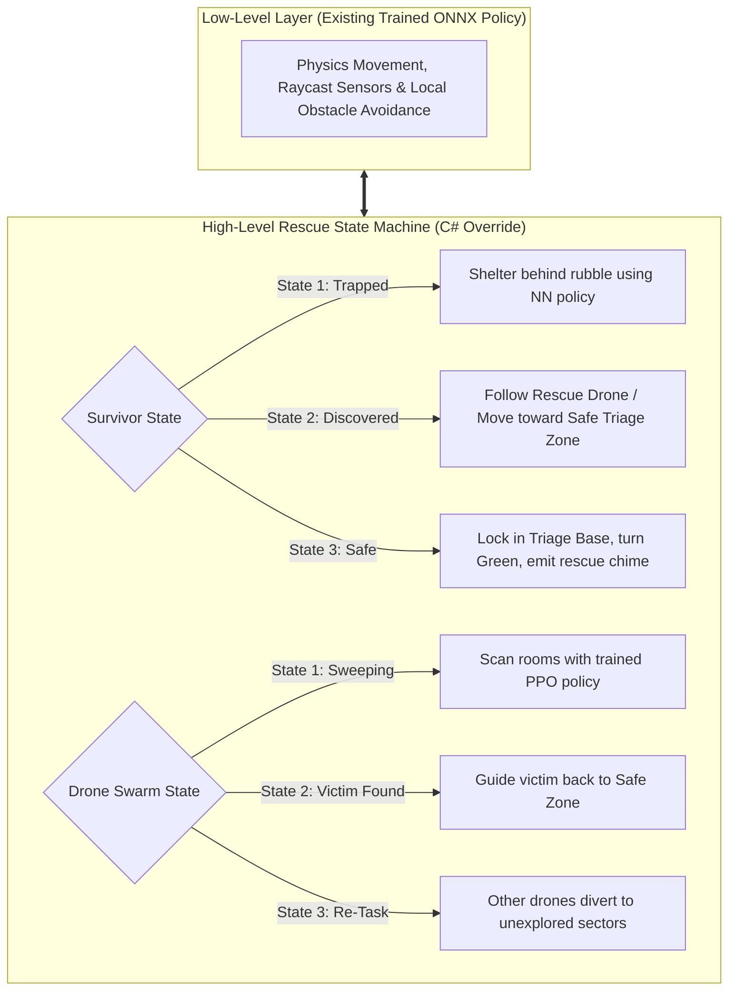
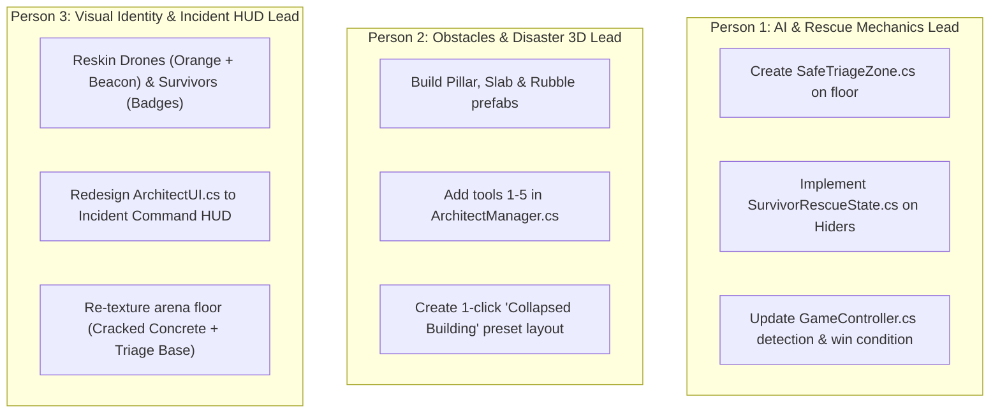

# ResQ-MARL: Disaster Rescue Transformation Blueprint
**The Complete Implementation Guide: AI Behaviors, Realistic Obstacles, Visuals & Team Work Plan**

---

## 1. Executive Summary & Project Purpose

### 1.1 The Objective
We are pivoting our project from an entertainment hide-and-seek game into **ResQ-MARL**: an **Autonomous Disaster Response & Urban Search-and-Rescue (USAR) Simulation Testbed**.

### 1.2 Why This Satisfies the Faculty & Review Committee
* **Real-World Utility:** Instead of playing a toy game, the system simulates autonomous robotic swarms (UAVs/UGVs) entering collapsed buildings after an earthquake to locate trapped survivors and evacuate them to safety.
* **Realistic Debris Obstacles:** Standard walls and cubes are replaced with realistic earthquake rubble—fallen concrete pillars, tilted roof slabs, rubble clusters, and hazard barricades.
* **Intelligent Hierarchical AI:** Victims don't run away forever; once discovered, they are escorted to a **Safe Triage Zone**. Rescue drones coordinate to sweep separate sectors rather than dogpiling the same target.
* **Incident Command Interaction (Hand & VR):** The human operator acts as the disaster Incident Commander, surveying the 3D collapsed site and manipulating debris.

---

## 2. System & Codebase Component Mapping

Every single script already in the repository directly maps to this disaster response scenario:

| Existing Script | Current Game Function | New Disaster Rescue Function | Key Changes Needed |
| :--- | :--- | :--- | :--- |
| [`HideAndSeekAgent.cs`](file:///c:/LostVayne/Work/Github/Arena-MARL-Game/Unity%20Project/Assets/Scripts/HideAndSeekAgent.cs) | Seekers hunting hiders | **Autonomous Rescue Swarm (UAVs/UGVs)** | Add sector re-tasking so drones don't chase the same survivor. |
| [`AgentActions.cs`](file:///c:/LostVayne/Work/Github/Arena-MARL-Game/Unity%20Project/Assets/Scripts/AgentActions.cs) | Hiders hiding / freezing on tag | **Trapped Survivors / Casualties** | Add 3-state enum: `Trapped` $\rightarrow$ `BeingEscorted` $\rightarrow$ `Rescued`. |
| [`GameController.cs`](file:///c:/LostVayne/Work/Github/Arena-MARL-Game/Unity%20Project/Assets/Scripts/GameController.cs) | Capture rule & win check | **Rescue Mission Controller** | Add `SafeTriageZone` check and mission completion when all victims reach safety. |
| [`BoxHolding.cs`](file:///c:/LostVayne/Work/Github/Arena-MARL-Game/Unity%20Project/Assets/Scripts/BoxHolding.cs) | Agents grabbing/locking boxes | **Debris Clearance & Manipulator Arm** | Drones push/pull fallen debris to open evacuation corridors. |
| [`SeekerLaserScanner.cs`](file:///c:/LostVayne/Work/Github/Arena-MARL-Game/Unity%20Project/Assets/Scripts/SeekerLaserScanner.cs) | Red laser vision cone | **Emergency Searchlight / Sensor Cone** | Retint from aggressive red to emergency amber/orange search beam. |
| [`ArchitectManager.cs`](file:///c:/LostVayne/Work/Github/Arena-MARL-Game/Unity%20Project/Assets/Scripts/Architect/ArchitectManager.cs) | Wall and box placement | **Incident Command Site Assessment** | Add tools for Pillars, Tilted Slabs, Rubble Mounds, and Barricades. |
| [`ArchitectUI.cs`](file:///c:/LostVayne/Work/Github/Arena-MARL-Game/Unity%20Project/Assets/Scripts/Architect/ArchitectUI.cs) | Build mode HUD | **Emergency Incident Command HUD** | Mission clock, Victims Located counter, Evacuated to Triage counter. |
| [`PlayerLayout.cs`](file:///c:/LostVayne/Work/Github/Arena-MARL-Game/Unity%20Project/Assets/Scripts/PlayerLayout.cs) | Save/load arena JSON | **Digital Twin Disaster Blueprint Loader** | Loads pre-configured collapsed building floorplans with 1 click. |

---

## 3. Hierarchical AI Architecture (Changing Behavior Without Retraining)

We **do not** need to retrain neural networks from scratch. We implement **Hierarchical AI**:
* **Low-Level Locomotion Layer (Existing ONNX Models):** Continues using the trained neural networks for physics-based movement, room navigation, and raycast obstacle avoidance.
* **High-Level Mission State Machine (C# Script Layer):** Overrides agent objectives based on rescue events.



### 3.1 Survivor AI: The 3-State Lifecycle
1. **State 1: Trapped / Sheltered**
   * Default state. The survivor remains sheltered under debris or behind fallen pillars (leveraging the trained hiding policy).
   * Emits a pulsing cyan distress ring and overhead text: `[TRAPPED - NEED RESCUE]`.
2. **State 2: Discovered / Being Escorted (The Crucial Pivot)**
   * When a rescue drone comes within `captureDistance` (1.2m), the survivor **stops hiding and stops running away**.
   * State switches to `BeingEscorted`.
   * Overhead badge updates to: `[EXTRACTING TO SAFETY]`.
   * The survivor's movement logic smoothly steers toward the rescue drone or the **Safe Triage Zone**.
3. **State 3: Safely Evacuated (Triage Safe)**
   * As soon as the survivor steps into the green Safe Triage Zone collider:
     * State switches to `Rescued`.
     * Overhead badge turns green: `[SAFELY RESCUED]`.
     * Agent stops moving, physics freezes, and the mission counter increments (`Rescued: 1/3`).

### 3.2 Rescue Drone Swarm AI: Cooperative Sweeping
* **Avoiding Redundant Dogpiling:** In the old game, all 3 seekers often chase the same hider.
* **Swarm Re-Tasking:** When Drone A detects Survivor 1, Drone A claims that survivor for escort. Drones B and C receive an event and **continue searching unexplored sectors** rather than chasing the same victim.

---

## 4. Concrete C# Implementation Code

Here is the exact code required to implement this rescue behavior cleanly:

### 4.1 Script 1: `SafeTriageZone.cs`
Attach this script to an empty GameObject on the arena floor with a `BoxCollider` set to `Is Trigger = true`:

```csharp
using UnityEngine;
using System;

public class SafeTriageZone : MonoBehaviour
{
    public static SafeTriageZone Instance { get; private set; }

    public event Action<AgentActions> OnSurvivorEvacuated;

    private void Awake()
    {
        Instance = this;
    }

    private void OnTriggerEnter(Collider other)
    {
        AgentActions agent = other.GetComponent<AgentActions>();
        if (agent != null && agent.IsHiding)
        {
            SurvivorRescueState survivor = other.GetComponent<SurvivorRescueState>();
            if (survivor != null && survivor.CurrentState == SurvivorRescueState.State.BeingEscorted)
            {
                survivor.MarkAsSafelyRescued();
                OnSurvivorEvacuated?.Invoke(agent);
            }
        }
    }
}
```

### 4.2 Script 2: `SurvivorRescueState.cs`
Attach this to the Hider / Survivor Prefab:

```csharp
using UnityEngine;

[RequireComponent(typeof(AgentActions))]
public class SurvivorRescueState : MonoBehaviour
{
    public enum State { Trapped, BeingEscorted, Rescued }
    public State CurrentState { get; private set; } = State.Trapped;

    [SerializeField] private float followSpeed = 2.5f;
    [SerializeField] private float stoppingDistance = 1.5f;

    private AgentActions agentActions;
    private Transform assignedRescuer;
    private Transform triageZoneTransform;
    private TextMesh statusBadge;

    private void Awake()
    {
        agentActions = GetComponent<AgentActions>();
        CreateStatusBadge();
    }

    private void Start()
    {
        if (SafeTriageZone.Instance != null)
            triageZoneTransform = SafeTriageZone.Instance.transform;
    }

    public void OnLocatedByDrone(Transform droneTransform)
    {
        if (CurrentState != State.Trapped) return;

        CurrentState = State.BeingEscorted;
        assignedRescuer = droneTransform;
        UpdateBadge("[EXTRACTING]", Color.yellow);
    }

    public void MarkAsSafelyRescued()
    {
        CurrentState = State.Rescued;
        agentActions.WasCaptured = true; // Freezes ML-Agents movement
        UpdateBadge("[SAFE]", Color.green);
    }

    private void FixedUpdate()
    {
        // When being escorted, steer toward the Safe Triage Zone or the Rescuer
        if (CurrentState == State.BeingEscorted)
        {
            Vector3 targetPos = triageZoneTransform != null ? triageZoneTransform.position : assignedRescuer.position;
            Vector3 diff = targetPos - transform.position;
            diff.y = 0;

            if (diff.magnitude > stoppingDistance)
            {
                Vector3 moveDir = diff.normalized;
                agentActions.ApplyMovement(new Vector2(moveDir.x, moveDir.z) * followSpeed * Time.fixedDeltaTime);
            }
        }
    }

    private void CreateStatusBadge()
    {
        GameObject badgeObj = new GameObject("StatusBadge");
        badgeObj.transform.SetParent(transform, false);
        badgeObj.transform.localPosition = new Vector3(0f, 1.6f, 0f);

        statusBadge = badgeObj.AddComponent<TextMesh>();
        statusBadge.fontSize = 28;
        statusBadge.characterSize = 0.08f;
        statusBadge.alignment = TextAlignment.Center;
        statusBadge.anchor = TextAnchor.MiddleCenter;
        UpdateBadge("[TRAPPED]", new Color(0f, 0.85f, 1f));
    }

    private void UpdateBadge(string text, Color color)
    {
        if (statusBadge != null)
        {
            statusBadge.text = text;
            statusBadge.color = color;
        }
    }

    private void LateUpdate()
    {
        // Keep badge facing the active camera
        if (statusBadge != null && Camera.main != null)
        {
            statusBadge.transform.rotation = Camera.main.transform.rotation;
        }
    }
}
```

### 4.3 Connecting Detection in `GameController.cs`
In [`GameController.cs`](file:///c:/LostVayne/Work/Github/Arena-MARL-Game/Unity%20Project/Assets/Scripts/GameController.cs), find the loop inside `FixedUpdate()` where capture distance is evaluated (around line 254), and change it to trigger the rescue state:

```csharp
// Inside GameController.cs - FixedUpdate()
if (allowCapture)
{
    for (int i = 0; i < seekers.Count; i++)
    {
        for (int j = 0; j < hiders.Count; j++)
        {
            SurvivorRescueState survivor = hiders[j].GetComponent<SurvivorRescueState>();
            if (survivor != null && survivor.CurrentState == SurvivorRescueState.State.Trapped)
            {
                float dist = Vector3.Distance(seekers[i].transform.position, hiders[j].transform.position);
                if (dist < captureDistance)
                {
                    // Trigger the rescue escort rather than freezing in place!
                    survivor.OnLocatedByDrone(seekers[i].transform);
                }
            }
        }
    }
}
```

---

## 5. Realistic Earthquake Obstacle Specifications

Replace plain walls and wood boxes with 4 realistic disaster debris types:

```text
+-----------------------------------------------------------------------------------------------+
|                             4 REALISTIC EARTHQUAKE OBSTACLES                                  |
+-----------------------------------------------------------------------------------------------+
|                                                                                               |
|  1. COLLAPSED CONCRETE PILLAR / BEAM               2. TILTED CONCRETE SLAB / RAMP             |
|     • Model: Elongated Cylinder / Cube                • Model: Ramp.prefab (Already in assets)|
|     • Scale: (0.8, 0.8, 5.0)                          • Scale: (2.5, 1.2, 4.0)                |
|     • Role: Fallen column blocking corridors          • Role: Collapsed roof slab/crawlspace  |
|                                                                                               |
|  3. RUBBLE CLUSTER / BROKEN MASONRY                4. EMERGENCY HAZARD BARRICADE              |
|     • Model: 3-4 small interlocking cubes             • Model: Thin barrier with hazard tape  |
|     • Scale: Irregular (1.2, 0.7, 1.5)                • Scale: (3.0, 1.2, 0.2)                |
|     • Role: Fractured concrete heap                   • Role: Placed to seal unstable zones   |
|                                                                                               |
+-----------------------------------------------------------------------------------------------+
```

### How to Build Each Prefab in Unity (No 3D modeling software required!):

#### Obstacle 1: Collapsed Concrete Pillar / Heavy Beam
* **How to create:** Right click in Hierarchy $\rightarrow$ `3D Object` $\rightarrow$ `Cylinder` (or Cube).
* **Transform:** Scale = `(0.8, 0.8, 5.0)`. Rotate X = `90` so it lies horizontally across the floor.
* **Component:** Add `Rigidbody` (Mass = 80, Drag = 5) and `BoxHolding` (so rescue drones can push it aside!).
* **Material:** Dark concrete gray material (`#52525B`).

#### Obstacle 2: Tilted Concrete Slab / Ramp
* **How to create:** You already have `Unity Project/Assets/Prefabs/Ramp.prefab`!
* **Transform:** Scale = `(2.5, 1.2, 4.0)`.
* **Role:** Represents a broken floor or roof section resting against a wall. Survivors can shelter beneath its incline, and rescue drones can drive up or scan under it.

#### Obstacle 3: Rubble Mound / Masonry Pile
* **How to create:** Create an Empty GameObject named `Rubble_Mound`. Add 3 child Cubes scaled to `(1.2, 0.6, 1.0)`, `(0.8, 0.8, 0.8)`, and `(1.0, 0.5, 1.4)`, rotated slightly at random angles (`15°`, `-20°`).
* **Component:** Add a single `BoxCollider` around the compound and a `Rigidbody`.
* **Material:** Dusty rough concrete material.

#### Obstacle 4: Emergency Hazard Barricade
* **How to create:** Duplicate `Wall.prefab`. Set Scale = `(3.0, 1.0, 0.2)`.
* **Material:** Add a yellow-and-black diagonal warning stripe material (or bright emergency orange `#EA580C`).
* **Role:** Placed by the Incident Commander to seal off structurally hazardous areas.

### Integrating New Debris into `ArchitectManager.cs`:
In [`ArchitectManager.cs`](file:///c:/LostVayne/Work/Github/Arena-MARL-Game/Unity%20Project/Assets/Scripts/Architect/ArchitectManager.cs), extend the `Tool` enum and placement methods:
```csharp
public enum Tool { 
    SpawnWall, 
    SpawnBox, 
    SpawnPillar,    // NEW: Key 3
    SpawnRampSlab,  // NEW: Key 4
    Demolish,       // Key 5
    PreLockHider 
}
```

---

## 6. Visual & Environmental Reskinning Guide

### 6.1 Rescue Drones (Seekers)
* **Body Tint:** Change from generic red to **High-Visibility Emergency Yellow / Orange** (`#F59E0B`).
* **Searchlight Scanner:** In [`SeekerLaserScanner.cs`](file:///c:/LostVayne/Work/Github/Arena-MARL-Game/Unity%20Project/Assets/Scripts/SeekerLaserScanner.cs), change `normalColor` from red to a warm emergency searchlight tone (`Color(1f, 0.75f, 0.2f, 0.6f)`).
* **Flashing Beacon:** Add a simple pulsing script or blinking emission material to the drone's top ring so it flashes like an emergency response vehicle.

### 6.2 Trapped Survivors (Hiders)
* **Distress Pulse:** Cyan pulsing light/ring (`#06B6D4`).
* **Overhead Badge:** 3D text showing `[TRAPPED]` in cyan, updating to `[EXTRACTING]` in amber, and `[SAFE]` in green.

### 6.3 Disaster Arena Environment
* **Floor:** Darken the blue floor tile to a cracked asphalt/concrete color (`#334155`).
* **Arena Perimeter:** Add a yellow-and-black hazard caution stripe texture along the perimeter walls.
* **Safe Triage Base:** A \(5m \times 5m\) square zone on one corner of the floor with a glowing green border and a white/green emergency medical cross.

### 6.4 Incident Command Post HUD ([`ArchitectUI.cs`](file:///c:/LostVayne/Work/Github/Arena-MARL-Game/Unity%20Project/Assets/Scripts/Architect/ArchitectUI.cs))
Replace the generic build HUD with an emergency dashboard:
* Header: `INCIDENT COMMAND POST — DISASTER RESPONSE SECTOR 4`
* Mission Clock: `Time to Structural Aftershock: 02:15`
* Status Ticker: `Victims Located: 2/3 | Safely Evacuated: 1/3`
* Tool Buttons: `[1] Wall | [2] Rubble Box | [3] Fallen Pillar | [4] Tilted Slab | [5] Excavate`

---

## 7. The 3-Person Team Work Distribution

Responsibilities are cleanly divided so each team member has an independent focus area:



### Detailed Task Breakdown:

#### Person 1: AI & Rescue Mechanics Lead
1. Add the `SafeTriageZone.cs` script to the scene and place the green trigger box in one corner of the arena.
2. Attach `SurvivorRescueState.cs` to the survivor prefabs.
3. Update [`GameController.cs`](file:///c:/LostVayne/Work/Github/Arena-MARL-Game/Unity%20Project/Assets/Scripts/GameController.cs) so that touching a survivor triggers `OnLocatedByDrone()` rather than instantly freezing them.
4. Update the win condition: round is won when `EvacuatedSurvivors == TotalSurvivors`.

#### Person 2: Obstacles & Disaster Environment Lead
1. Create the **Pillar** prefab (stretched cylinder) and configure the existing **Ramp** prefab into the **Tilted Slab**.
2. Create the **Rubble Mound** compound obstacle.
3. Add these new debris types into [`ArchitectManager.cs`](file:///c:/LostVayne/Work/Github/Arena-MARL-Game/Unity%20Project/Assets/Scripts/Architect/ArchitectManager.cs) with hotkey shortcuts.
4. Save a pre-configured disaster scene layout (`collapsed_building_preset.json`) that can be loaded instantly during the presentation.

#### Person 3: Visual Identity, Incident HUD & Presentation Lead
1. Retint Seekers to Emergency Hazard Orange and update [`SeekerLaserScanner.cs`](file:///c:/LostVayne/Work/Github/Arena-MARL-Game/Unity%20Project/Assets/Scripts/SeekerLaserScanner.cs) scanner beam color.
2. Add the floating 3D status badge above each survivor.
3. Redesign [`ArchitectUI.cs`](file:///c:/LostVayne/Work/Github/Arena-MARL-Game/Unity%20Project/Assets/Scripts/Architect/ArchitectUI.cs) text to display disaster response terminology (`Victims Located`, `Evacuated to Triage`).
4. Re-skin the floor and build the green Safe Triage Zone visual perimeter.

---

## 8. Simple Hand Movement & VR Integration (For Ma'am)

To address the professor's request for **hand movement and VR** without overcomplicating the codebase:
1. **The Presentation Concept:** The human player is the **Disaster Incident Commander**.
2. **Simple Gesture / Hand Control:**
   * A standalone 40-line Python script using **MediaPipe** reads the laptop webcam.
   * When the operator pinches their fingers together, it sends a simulated left-click or key press to Unity to pick up and place debris blocks touchlessly.
   * *Talking Point for the Professor:* *"The incident commander uses touchless gesture controls to survey the collapsed structure and manipulate hazardous debris remotely before sending rescue teams inside."*
3. **VR Mode:**
   * Using Unity's existing Main Camera, you can either enable first-person possession (pressing `Tab` already exists in your codebase!) or switch to standard OpenXR camera view to inspect the damage at a 1:1 scale.

---

## 9. Step-by-Step Implementation Timeline

| Timeline | Milestone | Verification Test |
| :--- | :--- | :--- |
| **Day 1** | **Safe Zone & Follow AI** | Survivor stops running when found; follows the drone to the green Safe Zone and turns green `[SAFE]`. |
| **Day 2** | **New Debris Obstacles** | Pressing keys 1–4 in Architect Mode spawns a wall, rubble box, fallen pillar, or tilted slab. |
| **Day 3** | **Visual Polish & Incident HUD** | Rescuers have orange searchlights; survivors have overhead badges; HUD shows disaster rescue status. |
| **Day 4** | **Preset & 5-Min Demo Rehearsal** | Click "Load Disaster Layout", run the simulation, and verify all 3 survivors are escorted to the triage base. |
