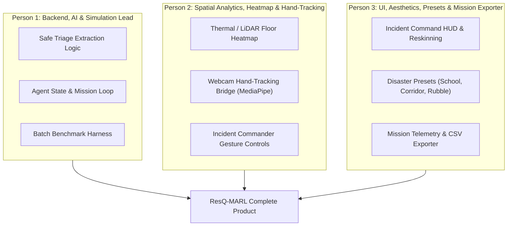
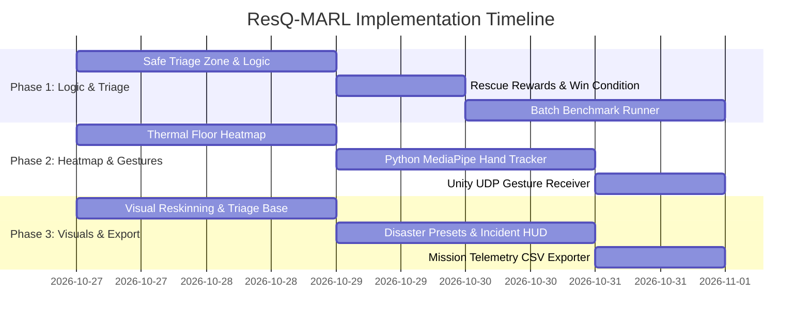

# ResQ-MARL: Project Pivot Master Plan
**Transforming Arena into an Autonomous Disaster Response & Urban Search-and-Rescue (USAR) Digital Twin Testbed**

---

## 1. Executive Summary & Objective

### 1.1 The Pivot Vision
We are transitioning the project from a multi-agent entertainment game ("Hide and Seek") into **ResQ-MARL**, a high-impact, academic-grade **Autonomous Disaster Response & Urban Search-and-Rescue (USAR) Simulation and Digital Twin Platform**.

In post-earthquake disaster scenarios, sending human first responders into collapsed buildings risks lives due to structural instability and aftershocks. **ResQ-MARL** provides a virtual simulation testbed that:
1. Trains and evaluates autonomous multi-agent swarms (UAVs/UGVs) navigating collapsed rubble.
2. Scans for trapped survivors using simulated LiDAR and thermal imaging.
3. Clears dynamic debris and establishes safe evacuation routes to a designated **Safe Triage Zone**.
4. Enables a human Incident Commander to survey damage, manipulate debris, and map real-world building blueprints in 3D using **VR and Touchless Hand Tracking**.

---

## 2. Work Breakdown: 3-Person Team Distribution

To ensure smooth execution, responsibilities are cleanly divided across 3 team members. No member is blocked by another.



---

### Person 1: Backend, AI & Simulation Lead
**Core Responsibility:** Game logic adaptation, rescue state management, and simulation benchmarking.

* **Task 1.1: Safe Triage Zone & Extraction Logic (`GameController.cs`)**
  * Define a `BoxCollider` trigger zone representing the **Safe Triage Base** on the arena floor.
  * When a rescue drone tags/discovers a survivor, change the survivor's status from `Trapped` to `Rescued`.
  * Guide or route rescued survivors toward the Safe Triage Base.
  * Trigger mission success once all survivors reach safety or the operational window expires.
* **Task 1.2: Rescue Reward & Win-Condition Refactoring (`GameController.cs`, `HideAndSeekAgent.cs`)**
  * Refactor existing capture rewards into **Rescue & Triage Rewards**:
    * Positive reward for detecting a survivor via line-of-sight thermal scan.
    * Major milestone reward when a survivor arrives in the Safe Triage Zone.
    * Time penalty for unrescued victims (encouraging fast extraction).
* **Task 1.3: Automated 10-Trial Batch Benchmark Runner (`GenerationComparer.cs`)**
  * Add a `RunBatchMission(int count)` method running 10 accelerated episodes (`Time.timeScale = 3f`).
  * Calculate statistical distributions: Mean Time to Rescue (MTTR), extraction rate (%), and sweep efficiency.

---

### Person 2: Spatial Analytics, Heatmap & Hand-Tracking Lead
**Core Responsibility:** Sensor visualization, floor coverage heatmap, and touchless gesture control.

* **Task 2.1: Spatial Thermal/LiDAR Floor Heatmap (`SpatialThermalHeatmap.cs`)**
  * Create a \(30 \times 30\) floor grid overlay.
  * During simulation, query raycast hits from rescue drones' thermal scanners (`SeekerLaserScanner.cs`).
  * Color-code floor cells:
    * **Bright Cyan / Green:** Area thoroughly swept by thermal sensors.
    * **Amber:** Partial sensor coverage.
    * **Red / Dark Slate:** Unexplored void pockets / High-risk blind spots.
  * Add hotkey `H` to toggle the heatmap overlay on and off.
* **Task 2.2: Touchless Webcam Hand-Tracking Controller (`webcam_hand_controller.py`)**
  * Develop a standalone Python script using **MediaPipe Hands** and **OpenCV** that tracks:
    * **Index-Thumb Pinch:** Grasp / move debris blocks.
    * **Open Palm:** Pan/rotate the tactical overview camera.
    * **Point Gesture:** Place structural hazard markers.
  * Transmit normalized `(x, y, gesture)` packets over UDP localhost (port 5005) at 30 FPS.
* **Task 2.3: Unity Hand-Tracking Receiver (`HandTrackingReceiver.cs`)**
  * Create a C# UDP listener script attached to the platform.
  * Map received hand coordinates to the cursor position in `ArchitectManager.cs` so the user can manipulate debris touchlessly without a mouse.
  * Keep keyboard/mouse controls as a seamless fallback.

---

### Person 3: UI, Aesthetics, Disaster Presets & Data Exporter Lead
**Core Responsibility:** Visual transformation, scenario loading, telemetry dashboard, and report export.

* **Task 3.1: Visual Reskinning & Environmental Aesthetics**
  * **Rescue Drones (Seekers):** Re-tint laser scanners from aggressive red to emergency infrared amber/cyan. Add an orange/yellow tactical ring.
  * **Survivors (Hiders):** Add floating overhead status badges: `[TRAPPED - SECTOR B]` $\rightarrow$ `[EXTRACTING]` $\rightarrow$ `[SAFE]`.
  * **Debris (Boxes):** Apply cracked concrete/rubble materials.
  * **Safe Triage Zone:** Build a luminous green floor perimeter mesh with a medical/hazard cross symbol.
* **Task 3.2: Incident Command HUD & Telemetry Dashboard (`ArchitectUI.cs`, `TacticalCameraController.cs`)**
  * Redesign the HUD into an **Emergency Incident Command Post**:
    * Mission Status: `DISASTER RECONNAISSANCE ACTIVE`.
    * Operational Clock: `Time to Structural Collapse: 02:45`.
    * Survivor Counter: `Victims Located: 2/3 | Extracted to Triage: 1/3`.
    * Live Coverage Gauge: `Thermal Sweep: 78.4%`.
* **Task 3.3: Pre-Configured Disaster Presets**
  * Create 3 architectural disaster templates loadable from a dropdown:
    1. *Collapsed School / Multi-Room Office* (High-density interior partitions, blocked doorways).
    2. *Blocked Corridor Chokepoint* (Linear corridor blocked by fallen rubble requiring clearance).
    3. *Open Rubble Field* (Scattered debris mounds and wide thermal search zones).
* **Task 3.4: One-Click Mission Audit Report Exporter**
  * Add an `"Export Mission Audit"` button.
  * Generate a timestamped CSV file in `DataSet/resq_mission_telemetry.csv` containing layout name, MTTR, survivor count, and thermal coverage %.

---

## 3. The 3-Phase Execution Timeline



### Phase 1: Core Mechanics & Rescue Loop (Days 1–2)
* Establish the Safe Triage Base on the arena floor.
* Transform tag events into survivor rescue states.
* Ensure inference models continue running smoothly with new rescue goals.

### Phase 2: Spatial Heatmap, Hand Tracking & Presets (Days 3–4)
* Implement the thermal sensor coverage floor heatmap (`H` toggle).
* Connect the webcam hand-tracking script via UDP to manipulate debris touchlessly.
* Configure the 3 disaster scenario presets in `ArchitectUI.cs`.

### Phase 3: Aesthetics, Telemetry Exporter & Defense Rehearsal (Day 5)
* Polish the Incident Command Post UI and visual materials.
* Implement one-click CSV mission data export.
* Conduct a full 5-minute presentation rehearsal following the defense script.

---

## 4. Comprehensive Change Inventory

### 4.1 Features to Add
| Feature | Target Script / File | Purpose |
| :--- | :--- | :--- |
| **Safe Triage Zone** | `TriageZone.cs`, `GameController.cs` | Extraction destination for rescued victims. |
| **Thermal Floor Heatmap** | `SpatialThermalHeatmap.cs` | Real-time visual proof of drone sweep coverage (`H` key). |
| **Touchless Hand Controller** | `webcam_hand_controller.py`, `HandTrackingReceiver.cs` | Webcam hand-tracking for debris clearance & camera pan. |
| **Disaster Presets** | `DisasterPresets.cs`, `ArchitectUI.cs` | 1-click loading of realistic collapsed building blueprints. |
| **Mission Telemetry Exporter** | `MissionTelemetryExporter.cs` | CSV logging of MTTR, clearance rate, and survival index. |
| **Overhead Survivor Badges** | `SurvivorStatusBadge.cs` | Visual labels indicating victim triage condition. |

### 4.2 Legacy Elements to Remove or Rename
| Legacy Game Element | Action | Replaced By / New Disaster Context |
| :--- | :--- | :--- |
| *"Hide and Seek"* references | **Remove / Re-label** | *"Urban Search and Rescue (USAR) Simulation"* |
| *"Hiders"* label | **Rename** | *"Trapped Survivors / Casualties"* |
| *"Seekers"* label | **Rename** | *"Autonomous Rescue Drones / Robots"* |
| *"Capture"* condition | **Refactor** | *"Victim Located & Secured"* |
| *"Demolish"* tool | **Rename** | *"Heavy Excavation / Debris Removal"* |
| *"Pre-Lock Box"* tool | **Rename** | *"Structural Shoring / Stabilize Debris"* |
| Toy-like bright cyan/red colors | **Restyle** | High-contrast emergency response theme (Hazard Amber, Slate, Triage Green). |

---

## 5. Visual & Aesthetic Transformation Guide

```text
+----------------------------------------------------------------------------------------------------+
|  [INCIDENT COMMAND POST — DISASTER SECTOR 4]            [MODE: AUTONOMOUS RECONNAISSANCE]          |
+----------------------------------------------------------------------------------------------------+
|  SCENARIOS: [Collapsed School v]   [RUN 10x STRESS TEST]   [THERMAL HEATMAP: ON]   [EXPORT AUDIT]   |
+----------------------------------------------------------------------------------------------------+
|                                                                                                    |
|                       (3D COLLAPSED BUILDING DIGITAL TWIN)                                         |
|                                                                                                    |
|    [RESCUE DRONE 1]                         [FALLEN BEAM / DEBRIS]                                 |
|    (Amber Thermal Cone) ------------>       [SURVIVOR: TRAPPED]                                    |
|                                                                                                    |
|                                                                    +--------------------------+    |
|                                                                    | SAFE TRIAGE BASE         |    |
|                                                                    | [EMERGENCY EVACUATION]   |    |
|                                                                    +--------------------------+    |
|                                                                                                    |
+----------------------------------------------------------------------------------------------------+
|  MISSION TELEMETRY: Thermal Sweep: 84.2% | MTTR: 21.4s | Rescued: 2/3 | Active Policy: PPO_200M    |
+----------------------------------------------------------------------------------------------------+
```

### Color Palette & Visual Assets:
* **Background & Structures:** Tactical Deep Slate (`#0F172A`), Industrial Concrete Grey (`#475569`).
* **Rescue Swarm:** High-Visibility Hazard Amber (`#F59E0B`) with infrared thermal scanner beams (`#FB923C`).
* **Trapped Survivors:** Life-sign Cyan pulse (`#06B6D4`), shifting to Green upon rescue.
* **Safe Triage Base:** High-illumination Medical Green (`#10B981`) with a luminous perimeter boundary.
* **Floor Heatmap:** Cool Blue/Green (cleared sectors), transitioning to Warning Red in uninspected voids.

---

## 6. Verification & Defense Checklist

Before meeting the professor for the final review, verify:
* [ ] The project boots with the title **ResQ-MARL: Autonomous Disaster Response Testbed**.
* [ ] Selecting the **Collapsed School** preset loads realistic debris and partitions.
* [ ] Pressing `H` toggles the **Thermal/LiDAR Coverage Heatmap** on the floor.
* [ ] Moving a hand in front of the webcam moves debris in the scene (or clean mouse fallback).
* [ ] Rescuing a survivor guides them to the green **Safe Triage Zone**.
* [ ] Clicking **"Export Mission Audit"** outputs a clean CSV file with **MTTR** and **Clearance %**.
* [ ] The team is prepared to deliver the **5-minute defense script** with confidence.
